# Conference-styled Confetti, with Livery

An exploration of adopting [Livery](https://github.com/yschimke/livery) (server-driven Remote
Compose templates) in Confetti: each conference gets its own look for headers, sessions,
speakers and promotions, across form factors, and the look can change without an app release.

Three catalogs are designed here: the **Confetti** base (the app's own purple, orange and blue,
tonal Material cards), which every conference without designs of its own draws; **droidcon**
(dark, terminal-flavoured, Android green); and **KotlinConf** (the Kotlin gradient, soft corners,
a gradient that drifts on the player's clock).

| | Confetti (base) | droidcon | KotlinConf |
| --- | --- | --- | --- |
| Header |  |  | 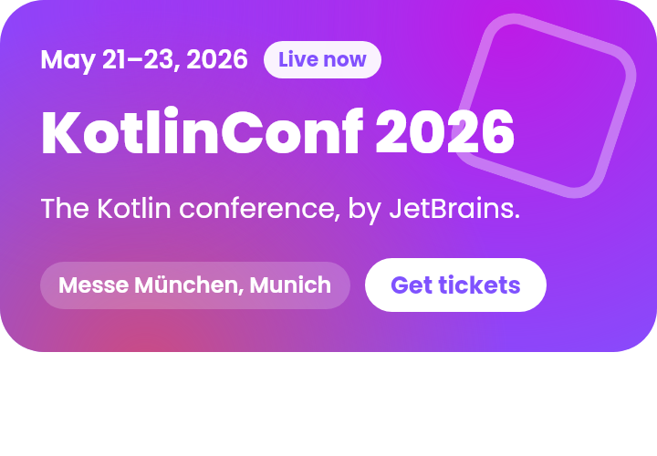 |
| Session |  | 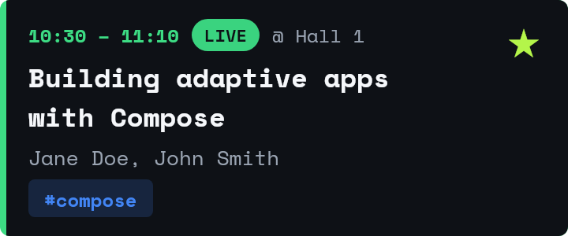 | 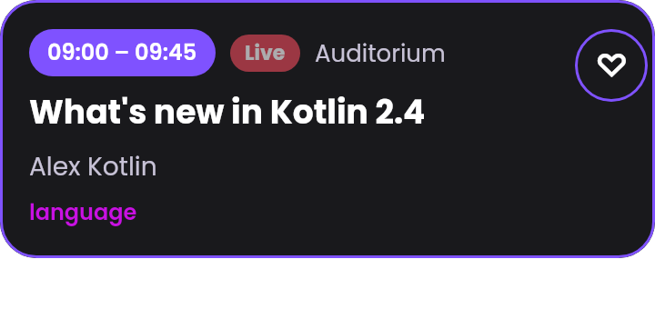 |
| Speaker |  |  | 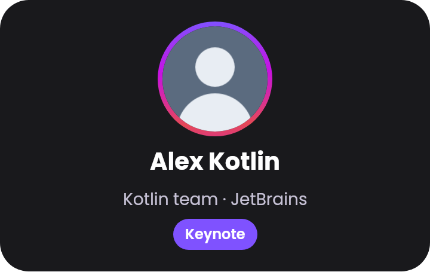 |
| Promotion |  | 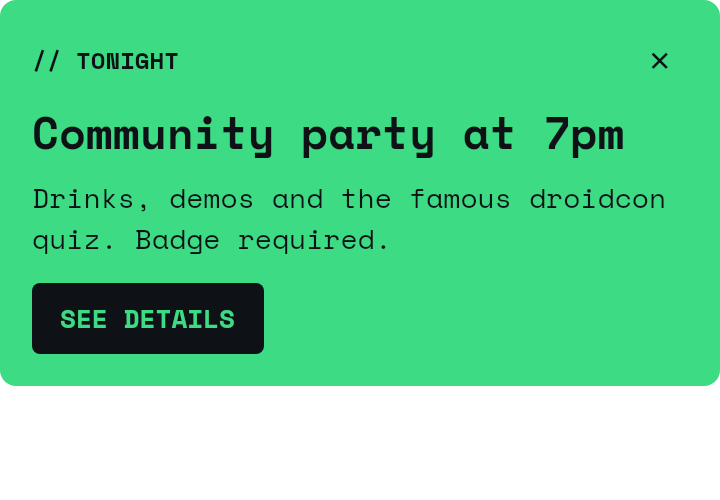 | 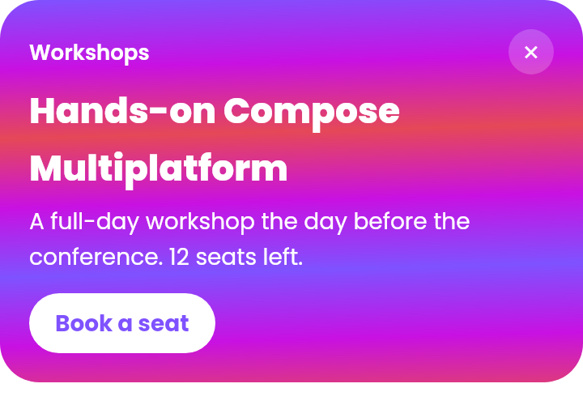 |
| Launcher widget | | 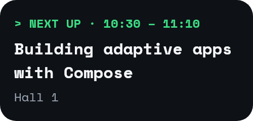 | 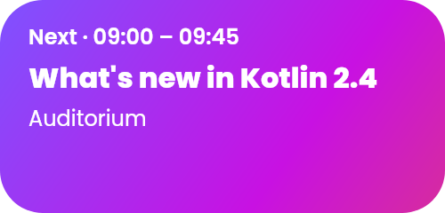 |
| Wear widget | | 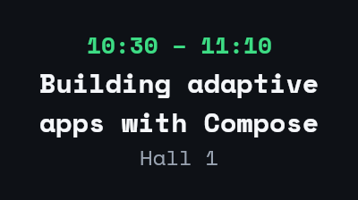 |  |

### Light, dark and Material 3 dynamic colour

Every colour in a design is a `theme.*` role, so a mode or a palette is data pushed beside the
slot's data, never a new document:

- **Light and dark.** Each catalog has a theme pack per mode (`confetti-light`, `droidcon-dark`,
  … in `catalogs/<series>/themes/`). A slot picks the
  one matching the app around it, judged from its `MaterialTheme`, so Confetti's own light or dark
  setting wins over the system's.
- **Material 3 dynamic colour.** When the user has dynamic colour on (`ConferenceMaterialTheme`
  sets `LocalDynamicColorInUse`), a slot pushes their `MaterialTheme.colorScheme` instead
  (`materialThemeValues` in `Contracts.kt`, one mapping for the app and these renders). Each
  conference keeps its layout and takes the user's wallpaper colours.

Changing the mode or the wallpaper recolours a slot live, without restarting its document.

| | Light | Dark | Dynamic (teal wallpaper) |
| --- | --- | --- | --- |
| Confetti |  | 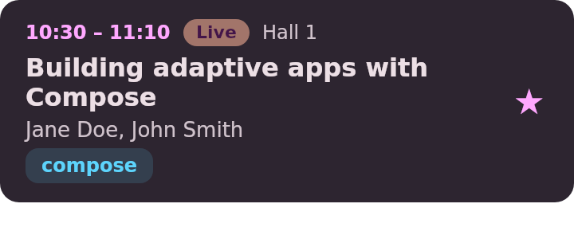 |  |
| droidcon | 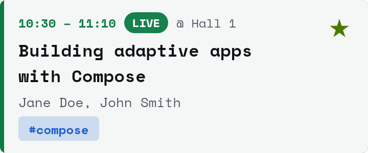 | 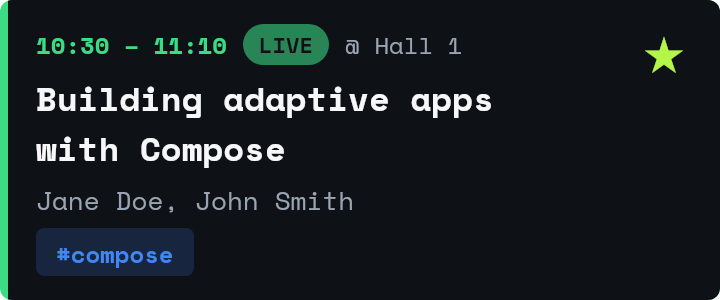 | 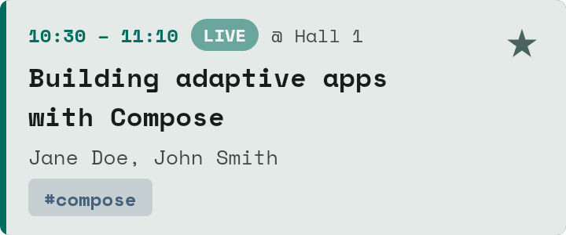 |
| KotlinConf | 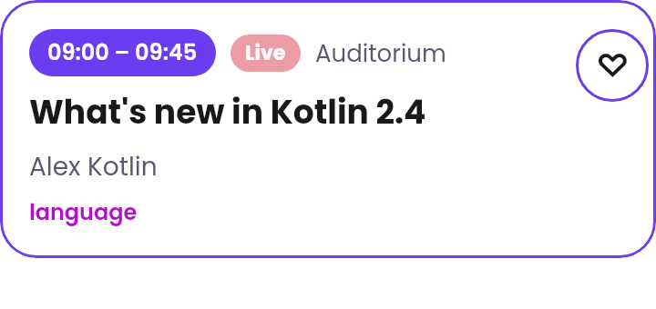 | 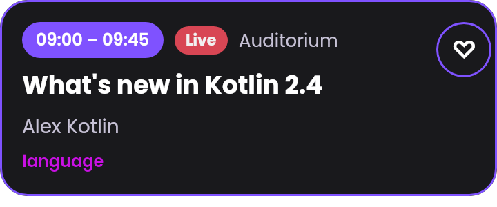 | 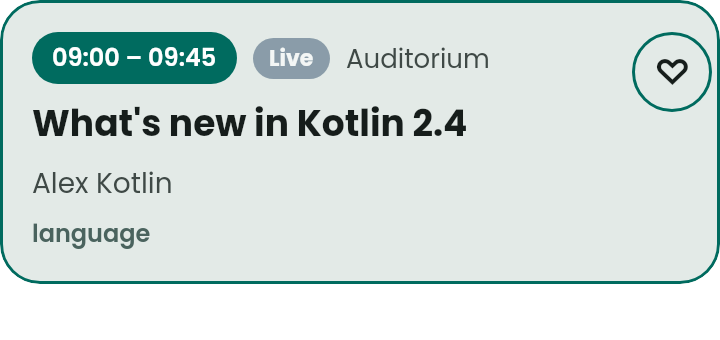 |

### In the app

The real Android path (`:livery`'s `LiveryComponentsTest`): the catalogs bundled into the
module's assets by `BuildLiveryCatalog`, picked by conference series, filled through the contract
and played in place of Confetti's row. droidcon and KotlinConf draw their own designs, and a
conference with no series (`fosdem2025`) draws the base catalog.

### An admin's change, as data

The same droidcon documents with a different theme pack (a venue blue for droidcon Berlin): no
new capture, no app release, just values.

| droidcon (catalog theme) | droidcon, Berlin theme pack |
| --- | --- |
|  |  |
|  | 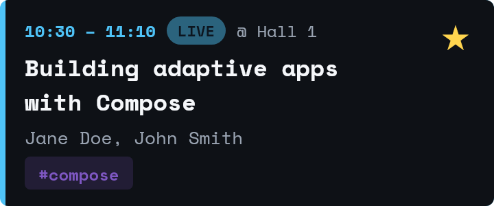 |
|  |  |

## How it fits together

```
livery-contracts/   Contracts.kt: the four contracts, typed (KMP: Android, iOS, JVM, wasm)
        │  used by both sides
        ├── livery-catalog/   designs as @RemoteComposable functions (rc-players' CMP fork of
        │                     remote-creation-compose), captured to .rc on the JVM, plus
        │                     plus themes, placements and fonts (data)
        │       └── catalogs/<series>/  one Livery catalog source tree per conference series:
        │                     what `livery build` publishes to the livery-templates branch
        │
        ├── shared/ui/components  ConferenceComponents: what the screens draw a conference's
        │                     header, session cards and promotions with (a context parameter):
        │                     NativeComponents, or SduiComponents choosing per conference. No
        │                     Livery types: shared doesn't depend on Livery
        └── livery/           (Android library, in the app only as sduiDebugImplementation)
                              LiveryComponents: contract-typed slots with the native row as the
                              fallback; Firebase Remote Config arms; the repositories (every
                              catalogs/<series> bundled into its assets); Livery on the app's
                              OkHttpClient. Found by the app through ServiceLoader
                              (ConferenceComponentsFactory), so no other variant links it
```

```bash
./gradlew :livery-catalog:generateLiveryCatalog   # capture designs, write catalogs/ and renders/
./gradlew :livery-catalog:test                    # contract checks; catalogs/ match the sources
./gradlew :livery-catalog:buildLiveryChannels     # livery build --inspect per series -> build/livery-channels/
./gradlew :livery-contracts:jvmTest
./gradlew :livery:testDebugUnitTest                # slots, arms and fallbacks on Robolectric
```

## The contract

The contract between the app and a design is the one thing both sides must agree on, so it's
enforced at every step. `Contracts.kt` is the source of truth:

1. **Types.** Designs read `input(SessionContract.title)` and emit `emit(SessionContract.open)`,
   not strings. The app builds data with `SessionContract.data(mapOf(SessionContract.title to …))`.
   Renaming an input breaks both sides at compile time.
2. **Capture.** A template captured for one contract that reads another contract's input fails
   the capture. `reads` and `emits` in each `<template>.json` are recorded while capturing, so
   they can't drift from the document.
3. **Generation checks** (`CatalogTest`): every example binds through Livery's `ContractBinder`
   (the gate devices use), every design emits each of its contract's actions and shows every
   required input, theme packs only set theme roles, and placements carry data their design's
   contract accepts. The checked-in `catalogs/` must equal what the sources generate.
4. **Livery's publisher**: `livery build --inspect` decodes every `.rc` and checks it against its
   sidecar (the Android build runs this through the Gradle plugin).
5. **Runtime**: binding refuses unknown or over-long values, so the app trims first
   (`Input.fit`). An action the contract doesn't declare, or a URL outside the allowlist, is
   dropped.

Contracts evolve per Livery's rules: within a major, only add optional inputs and actions.

| Contract | Data from | Inputs | Actions |
| --- | --- | --- | --- |
| `confetti/conference@1` | app | name, dates, location, tagline, live, ticketsUrl | tickets (open-url) |
| `confetti/session@1` | app | title, speakers, room, time, tag, live, bookmarked | open, bookmark |
| `confetti/speaker@1` | app | name, tagline, photo, sessions | open |
| `confetti/promo@1` | decision | eyebrow, headline, body, cta, url | cta (open-url), dismiss |

Every contract also takes the conference palette as theme roles (`theme.primary`, …).

## What each of the four goals looks like

1. **Conference-styled components.** Designs carry a `series` tag (`droidcon`, `kotlinconf`);
   the app maps a conference id to its series (`ConferenceSeries`) and asks for that tag. A
   conference with no series draws the base catalog (`ConferenceSeries.catalogFor`), and any
   platform root that passes `NativeComponents()` keeps Confetti's own UI.
2. **Conference assets.** The header shows the conference's own branding and copy, and a theme
   pack per series (`catalogs/<series>/themes/`) holds the palette as data: change a colour there and every
   template follows, with no new document.
3. **Promotions.** `catalogs/<series>/placements/` holds rules for `home.feed`, `session.footer` and
   `speaker.footer`: schedules, conference segments (`conference:<id>`), sticky rollouts and
   frequency caps, decided on the device. A promotion server could answer the same placements
   later (`FirstDecider`).
4. **Animation and polish.** Animations are remote expressions on the player's clock, not
   recomposition: the "live" pills breathe, the KotlinConf gradient drifts and its diamond
   turns. They cost nothing on the app side and work in a widget host that can play them.

## Form factors

| Surface | Status here |
| --- | --- |
| Phone and tablet (Android) | Wired: agenda header, promotion and session cards, promotions under sessions and on speaker pages. Only in the `sduiDebug` build type (see below); every other variant draws Confetti's own UI |
| iOS, desktop, web | The same shared components compile for every target; each platform root passes a `ConferenceComponents` into `App()` (today `NativeComponents()`; Livery's needs a repository and a bundled or hosted catalog) |
| Launcher widget | Templates authored (`launcher` target); next: a `LiveryLauncherWidgetProvider` for "next session" |
| Wear | Templates authored (`wear-widget`, `wear:large`); next: a `LiveryWearWidget` beside the existing tiles |

## An admin changing a design from the app

Livery already has the pieces for an agent to change a design safely; the flow for a
conference admin would be:

1. In the app (admin role), long-press a styled slot and write a request ("make the droidcon
   header say Berlin and use the blue from the venue"). The app sends it with the slot's
   design id, contract and current data to an agent session.
2. The agent works on this source tree through `livery-mcp` (`livery-mcp livery-catalog/catalogs/droidcon
   --write --preview-out …`): `get_contract` for what it may use; data-only changes (copy, a theme
   pack's colours, a placement's schedule) are JSON edits checked by `validate_data`; a layout
   change edits the design's Kotlin and is re-captured. `render_preview` shows the result.
3. `build_preview` / `publish_preview` publish an unsigned preview channel; the admin's debug
   build plays it in place, with their real data.
4. Approved, it becomes a PR here: CI runs `CatalogTest` and `livery build --inspect`, then
   `livery check` against main marks any contract change that isn't compatible. Merging signs
   and publishes the catalog; apps pick it up on their next refresh.

The strong contract is what makes this safe: an agent can change everything about a design
except what it reads and emits, and anything that would break the app fails before review.
Most admin requests are data (copy, colours, schedules), which is why the palette lives in theme
packs and promotions in placements, not in the documents.

## The `sduiDebug` variant: server templates, baked-in fallback, an A/B test

`sduiDebug` is `debug` plus the `:livery` module. Every other variant (`debug`, `release`,
`githubRelease`) doesn't link it, draws Confetti's own UI and ships no catalog. `:livery` itself
builds, tests and previews in its own debug and release, so CI covers it without the variant.

```bash
./gradlew :androidApp:installSduiDebug
./gradlew :androidApp:installSduiDebug -Pconfetti.livery.arm=native     # pin an arm (QA, screenshots)
./gradlew :androidApp:installSduiDebug -Pconfetti.livery.templates=https://host/catalogs   # another channel
```

**One catalog per conference, and a base.** `catalogs/confetti`, `catalogs/droidcon` and
`catalogs/kotlinconf` are separate Livery catalogs (`confetti-confetti`, `confetti-droidcon`,
`confetti-kotlinconf`), each with its own designs, theme packs, placements and fonts. They
publish, cache, expire and fail independently: a broken droidcon publish can't blank KotlinConf's
agenda. A new directory under `catalogs/` is bundled and published without build changes.

**Where a slot's design comes from, in order:**

1. **The server.** `livery-templates` on this repository, one static channel per series
   (`catalogs/<series>/manifest.json`, read from raw.githubusercontent.com). The *Livery templates*
   workflow publishes it on every merge to main that touches the catalogs, and weekly so the
   manifest doesn't expire. Slots ask for a refresh at most every five minutes; a downloaded
   catalog has a higher serial than the bundled one, so it wins, and open slots replan on the
   repository's revision.
2. **Baked in.** The same source trees, built and checked (`--inspect`) into the APK's assets at
   `livery/<series>/` by `:livery`'s `BuildLiveryCatalog` tasks, so only sduiDebug's APK has them. First launch and offline
   draw these.
3. **Confetti's own composable**, while a slot plans, when no catalog has a template for it, or
   when the user is in the native arm (where Livery is never built). So the old composables can be deleted only once
   every slot has a template in the bundled catalog.

Later the channel can move to `joreilly/confetti-templates` (a repository of its own fits
`GitHubReleaseSource`'s `releases/latest`), and a release build needs a signed manifest (below).

**Different designs and fonts.** droidcon is set in **Space Mono** (terminal-flavoured, green on
black) and KotlinConf in **Poppins** (round, on the Kotlin gradient), both OFL-1.1; the base
uses the platform's default face, shipped in
each catalog's `fonts/` and downloaded with the templates that name them. `Label` sets every
text in its brand's face (`RemoteFontFamily.Named`), capture records it in the sidecar's
`fonts`, and `CatalogTest` checks every template names its brand's face and that the catalog
ships it. The renders use the same files.

| droidcon (Space Mono) | KotlinConf (Poppins) |
| --- | --- |
|  |  |

**Screens draw through `ConferenceComponents`.** The agenda, session and speaker screens take it
as a context parameter (`context(components: ConferenceComponents)`) and call
`components.SessionCard(…)`, `components.ConferenceHeader(…)` and `components.Promo(…)`. The
parameter is threaded from `App()` down, with no CompositionLocal: Android's `MainActivity` passes
the one Koin built (`ConferenceComponentsFactory.load()?.create(…) ?: NativeComponents()`), and
iOS, desktop, web, previews and wrappers pass `with(NativeComponents()) { … }`. The interface has
no Livery types, so:

- `NativeComponents` is Confetti's own composables, and what every build but sduiDebug uses;
- `LiveryComponents` draws the conference's designs, falling back to `NativeComponents`;
- `SduiComponents` picks one per conference from its arm, and builds the Livery side on first
  use, so a session where every conference is in the native arm never constructs a repository,
  reads a bundled catalog or fetches a template (`LiveryComponentsTest.nativeArmNeverBuildsLivery`).

**The A/B test: Livery against the composables, in Firebase.** Each series has a Remote Config
parameter, `sdui_droidcon`, `sdui_kotlinconf` and `sdui_confetti` (every conference on the
base catalog), set to `native` or `livery`. Run the split as a
Firebase A/B Testing experiment on them, say 50/50 for droidcon and 25/75 for KotlinConf: Firebase
assigns users, counts exposures and reads the outcome from Analytics. The app reads each arm once
per process before drawing, so a background fetch never swaps the UI mid-session. A series with
no value yet (first launch before a fetch, or no Firebase) draws `livery`.
`-Pconfetti.livery.arm=native|livery` pins it for QA.

**The kill switch.** `livery_enabled` in Remote Config, `true` by default. Set it to `false` and
every conference draws Confetti's own composables, whatever its arm, and Livery isn't built at all:
no repository, bundled catalog or player. It's read once per process like the arms, so it takes
effect at the next launch after the app fetches it. While it's off, every event reports
`exp_sdui=native`, so pause the A/B test until it's back on.

**Animated headers, and shaders next.** Each header is a slow mesh gradient: radial glows of the
theme's colours, layered over the card and drifting on `animationTime` (`meshGlows` in
`Common.kt`). That needs no shader, so it plays on every client. AGSL shaders are the follow-up
experiment. They need rc-players' `RemoteBrush.runtimeShader` (yschimke/rc-players#826), or
`ShaderData` written straight to the document writer. Not every client can run them: AndroidX's
player needs Android 13 or later and the AndroidX profile, and widget hosts can't run them at all.
So a shader header would ship as its own design, alongside the mesh one, and be picked only for
clients that report shader support. Everyone else gets the mesh design, or a server-rendered
static image of the shader.

**Interaction tracking.** Every event goes to Confetti's own `AnalyticsLogger`, as Livery's flat
analytics events (logcat in debug, Firebase in release):
- `livery_impression`, `livery_viewable` and `livery_leave` with `duration_ms`;
- `livery_action`, whose `action` is the contract action (`open`, `bookmark`, `tickets`, `cta`).

Every event carries `exp_sdui` with the arm. In the native arm, Confetti's own session row
(in either arm, the livery arm's fallback rows included) reports its impression and taps under the same action names with `design_id=native`, through
`SduiTracking`, which logs without loading Livery. So tap-through compares across arms.

## Findings

### What works well

- **The contract as Kotlin objects.** Designs and app both use `SessionContract.title`, so a rename
  breaks both at compile time, and capture refuses another contract's input. Nothing about the
  per-conference split or the experiment needed a contract change.
- **Data-only changes.** Colours (theme packs per mode), promotions (placements), the experiment
  split and the fonts are files in the catalog. Only layout needs a re-capture.
- **Fallback by construction.** `LiverySlot` draws the fallback while planning and whenever there's
  no template, so the composables were the native arm for free.
- **Publishing as static files.** `livery build` output is a plain directory. A branch plus
  raw.githubusercontent.com was enough, and the bundled copy uses the same builder, so "baked in"
  and "from the server" can't drift apart.
- **Analytics shape.** `AnalyticsEventSink` fit Confetti's existing `AnalyticsLogger` with a
  three-line adapter, so iOS and web get the events through their own loggers too.
- **One HTTP stack.** Livery's `KtorFetcher` takes any Ktor client, so `liveryHttpClient` builds it
  on the app's own `OkHttpClient` (its pool, cache and interceptors) with Livery's settings: no
  automatic redirects (Livery checks each hop) and its timeouts. The Remote Compose player gets
  the same from rc-players 2.24 (yschimke/rc-players#825): OkHttp as its engine on Android and the
  JVM instead of CIO, and `rememberCoilRcImageLoader(httpClient)` to pass the app's client.

### Friction and boilerplate (candidates for Livery)

- **Native vs Livery isn't a Livery experiment.** A catalog experiment can only be read once the
  catalog is loaded, which is exactly what the native arm must avoid. So the arm comes from
  Firebase, before Livery. The app also tracks native rows in Livery's event shape itself
  (`SduiTracking`). **Livery could provide this pattern** as a small Livery-free module:
  - a `components` interface split, as here;
  - an `ArmSource` (Remote Config, local bucketing) read before any repository is built;
  - a native tracker that emits Livery's event names without its runtime.

  Then "Livery vs what we had" is configuration, not app code.
- **Arms ignore slot context.** `Experiments` takes one `DecisionContext` provider, but per
  conference arms depend on the conference. `arm(id, context)` would fix it, for design arms
  inside a catalog.
- **One catalog per Gradle plugin.** The plugin bundles one source tree into every variant. Per
  conference and per build type meant registering `BuildLiveryCatalog` tasks by hand (the class is
  public, which saved it). A `livery { catalogs { register("droidcon") { … } }; variants = … }`
  DSL would remove that.
- **A repository per catalog is a lot of wiring.** Each series needs its own `TemplateRepository`
  with separate blob and key-value stores, its own `Experiments`, `SlotPlanner`, `Decider` and
  `LiveryHost`. A `LiveryCatalogs(sources, bundled = { "livery/$it" })` would keep apps from getting
  the store separation wrong.
- **Refresh is the app's job.** Nothing calls `TemplateRepository.refresh()`. Slots here call it
  throttled. Livery could offer `repository.refreshWhileObserved()` or a WorkManager helper.
- **Expiry needs a scheduled republish.** `expiresInDays` applies to downloaded manifests, so an
  idle catalog must be rebuilt (the weekly cron). That's correct for signed catalogs, but it's
  easy to miss: the app silently drops back to the bundled copy.
- **Font names are case-folded by the player.** A custom `RcTypefaceLoader` (the renders here) must
  match families case-insensitively. `LiveryTypefaceLoader` does, and `livery-render` could take
  a catalog's `fonts/` directly.
- **Unchanged from 0.2.0:** slot height is the capture height, so wider faces (Space Mono) clip
  sooner. `open-url` builds `{"url":"…"}` in the document. Sidecars and typed contracts are still
  hand-rolled (`Authoring.kt`; `livery-capture`'s `LiveryValues` isn't published to Maven yet).

### Contracts and the app's model (DAO objects)

Options weighed for getting Apollo's `SessionDetails` into a slot:

- **Interfaces the model implements.** Not possible: the models are generated, and they carry
  fields a design must not see.
- **`Map<Input, Any>` built at each call site** (0.2.0 branch). Type-safe keys, but not values or
  completeness. It's easy to forget an input or to skip `fit`.
- **Copy into a data class per contract (chosen).** `SessionCard`, `SpeakerCard` and
  `ConferenceCard` in `:livery-contracts` (`ContractData.kt`):
  - one mapping function per model (`SessionDetails.toSessionCard`);
  - `values()` fits every string, drops blanks and refuses non-https images;
  - `ContractDataTest` fails when a contract gains an input its class doesn't fill.

  The native composable can take the same class. Then both arms draw the same data, and deleting
  an old composable touches nothing around it. That's the next step here: `SessionItemView`
  still takes `SessionDetails`.

What Livery could add: generate these classes, the JSON and the checks from the contract (KSP
or a Gradle task over `contracts/*.json`), validated at the same `ContractBinder` gate.

### Does Livery need a way to publish themes?

Partly. Theme packs already publish as catalog data: they ship in the manifest, an admin changes
them as JSON, and `repository.theme(id)` reads them. What's missing:

- **Theme-only publishing.** A colour change rebuilds and republishes the whole catalog. A
  `themes` channel, or a manifest that can reference a theme document by hash, would make a
  recolour a tiny, fast update.
- **Typography in themes.** Fonts sit in `fonts/` and are named per template. A theme pack that
  could map `theme.font.display`/`theme.font.body` roles to families would let a conference change
  its face without a re-capture, the way colours already work.
- **One theme for the whole app.** Confetti's native UI has its own per-conference Material
  schemes. Exporting a pack as a Material 3 `ColorScheme` (the inverse of `materialThemeValues`)
  would give native and Livery slots one source of truth.

## Friction found in 0.1.1, fixed in Livery 0.2.0

Found doing this, fixed in [yschimke/livery#14](https://github.com/yschimke/livery/pull/14) and
released in Livery 0.2.0 (this branch is on 0.4.0):

- **Compose version.** Livery 0.1.1 is built against Compose Multiplatform 1.13.0-beta02. Confetti
  pins the stable androidx Compose BOM (runtime 1.12.1), so the app compiles and then every slot
  crashes with `NoSuchMethodError`. It also pulls a beta CMP into `shared`'s other targets. 0.2.0
  builds on stable 1.12.2.
- **Bundled catalog without placements or themes.** `manifest()` is only the downloaded catalog,
  so a fresh install never decided a placement. 0.2.0 adds `current()` and `theme(id)`, which
  `LiveryStyling` uses.
- **Opaque agent errors.** `livery-mcp` said "internal error" when Skia failed to load on a
  headless host. It now says why and how to fix it.
- **Stale getting-started step**, pointing at a snapshot composite build.

The ones still open are under **Findings** above.
